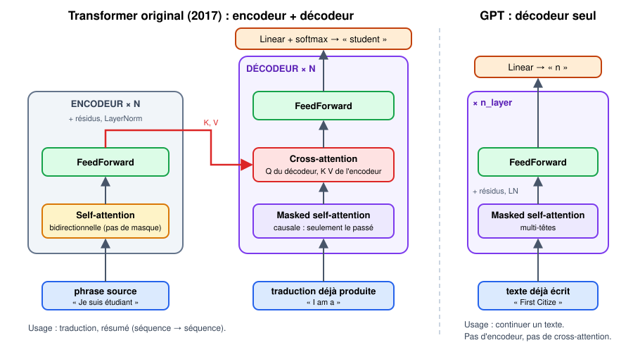

<!-- _class: lead -->

# Encodeur, décodeur… et pourquoi GPT n'a gardé qu'une moitié

## Support du notebook 04 · 10 minutes

<!--
À projeter après le notebook 03, avant d'ouvrir le 04. Objectif : que les étudiants sachent ce qu'on N'implémente PAS, et pourquoi.
-->

---

# Le problème d'origine : traduire

- Entrée : une phrase **complète** en anglais.
- Sortie : une phrase en français, **écrite mot après mot**.
- Deux besoins différents :
  1. **comprendre** toute la phrase source → on a le droit de tout regarder ;
  2. **écrire** la traduction → on ne peut regarder que ce qu'on a déjà écrit.

> Deux besoins → deux moitiés : **encodeur** et **décodeur**.

<!--
Poser la question : "Quand vous traduisez une phrase, la lisez-vous en entier avant de commencer ?" Oui → c'est l'encodeur. "Et quand vous écrivez la traduction, connaissez-vous le mot que vous allez écrire dans 3 mots ?" Non → c'est le masque du décodeur.
-->

---

# Le Transformer de 2017

- **Gauche — encodeur × 6** : self-attention **sans masque** + FeedForward.
- **Droite — décodeur × 6** :
  1. self-attention **masquée** ;
  2. **cross-attention** vers l'encodeur ;
  3. FeedForward.
- Partout : résidus (*Add*) et LayerNorm (*Norm*).

dvgodoy, Wikimedia Commons, CC BY 4.0 · Vaswani et al., 2017

---

# Trois attentions, une seule formule

$$\text{softmax}\left(\frac{QK^\top}{\sqrt{d}}\right)V$$

| | Q vient de… | K, V viennent de… | Masque ? |
|---|---|---|---|
| Self-attention de l'**encodeur** | la phrase source | la phrase source | **non** |
| Self-attention du **décodeur** | la traduction | la traduction | **oui** (causal) |
| **Cross-attention** | la traduction | l'**encodeur** | non |

> La différence de code entre self-attention d'encodeur et de décodeur : **une ligne**, le `masked_fill`.

<!--
C'est LA diapo à faire retenir. Insister : même mécanisme, seules changent la provenance de Q/K/V et la présence du masque.
-->

---

# La cross-attention en une phrase

> Pour écrire le mot suivant, chaque position de la traduction **pose une question** (Q) et va chercher la réponse **dans la phrase source** (K, V).

Exemple : en écrivant « étudiant », la query du décodeur trouve la clé de *student* dans l'encodeur, et récupère sa valeur.

C'est le seul endroit où les deux moitiés communiquent.

---

# Et GPT ?

---

# GPT : continuer un texte, il n'y a pas de « source »

- Pas de phrase à traduire → **pas d'encodeur**.
- Pas d'encodeur → **pas de cross-attention** (elle n'aurait rien à consulter).
- Il reste : **self-attention masquée + FeedForward**, × `n_layer`.

C'est un **Transformer decoder-only**. C'est ce que nous construisons.

> « Traduire » peut quand même se faire avec un GPT : on écrit la phrase source **dans le contexte** (`"Traduire en français : I am a student →"`), et le modèle continue.

---

# Trois familles

| Famille | Exemple | Ce qu'il voit | Usage |
|---|---|---|---|
| **Encoder-only** | BERT | toute la phrase (pas de masque) | classer, rechercher, comprendre |
| **Encoder-decoder** | Transformer 2017, T5 | source entière + passé de la sortie | traduire, résumer |
| **Decoder-only** | GPT, LLaMA, Claude, Mistral | le passé seulement | générer, dialoguer |

Les grands modèles de langage actuels sont presque tous **decoder-only** : une seule pile, une seule tâche (prédire le token suivant), et tout le reste s'écrit dans le contexte.

---

# Ce que notre mini-GPT change aussi par rapport au papier

| | 2017 | Notre mini-GPT |
|---|---|---|
| Tokens | sous-mots (~37 000) | caractères (65) |
| Position | sinusoïdes fixes | table apprise |
| Normalisation | post-norm `LN(x + f(x))` | **pré-norm** `x + f(LN(x))` |
| Taille | 512 canaux, 8 têtes, 6 couches | 64 canaux, 4 têtes, 4 couches |

Le **principe** est identique.

---

<!-- _class: lead -->

# À retenir

## Encodeur = tout voir · Décodeur = voir le passé · Cross-attention = le décodeur consulte l'encodeur

## GPT = décodeur seul, sans cross-attention

Pour aller plus loin : vidéo de Karpathy, chapitre *« encoder vs. decoder vs. both (?) Transformers »* · J. Alammar, *The Illustrated Transformer*
