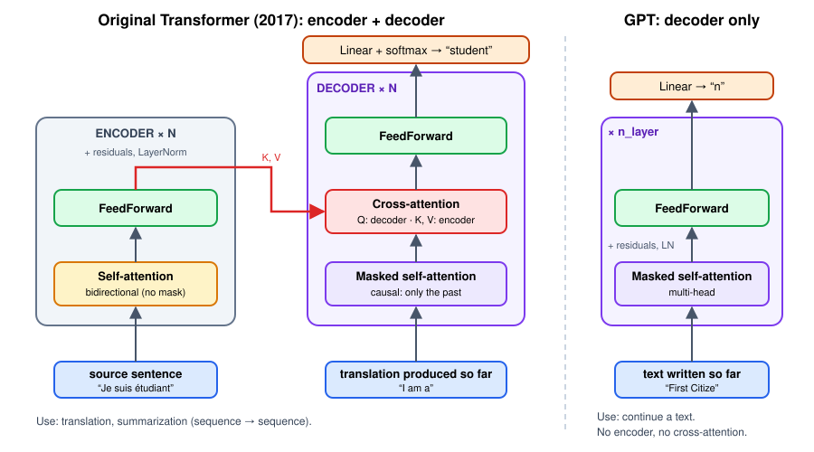

<!-- _class: lead -->

# Encoder, decoder… and why GPT kept only one half

## Companion to notebook 04 · 10 minutes

<!--
Show after notebook 03, before opening 04. Goal: students know what we do NOT implement, and why.
-->

---

# The original problem: translation

- Input: a **complete** sentence in English.
- Output: a sentence in French, **written word by word**.
- Two different needs:
  1. **understand** the whole source sentence → we are allowed to look at everything;
  2. **write** the translation → we can only look at what we have already written.

> Two needs → two halves: **encoder** and **decoder**.

<!--
Ask: "When you translate a sentence, do you read all of it before you start?" Yes → that's the encoder. "And when you write the translation, do you know the word you will write 3 words from now?" No → that's the decoder's mask.
-->

---

# The 2017 Transformer

- **Left — encoder × 6**: self-attention **without a mask** + FeedForward.
- **Right — decoder × 6**:
  1. **masked** self-attention;
  2. **cross-attention** to the encoder;
  3. FeedForward.
- Everywhere: residuals (*Add*) and LayerNorm (*Norm*).

dvgodoy, Wikimedia Commons, CC BY 4.0 · Vaswani et al., 2017

---

# Three attentions, one formula

$$\text{softmax}\left(\frac{QK^\top}{\sqrt{d}}\right)V$$

| | Q comes from… | K, V come from… | Mask? |
|---|---|---|---|
| **Encoder** self-attention | the source sentence | the source sentence | **no** |
| **Decoder** self-attention | the translation | the translation | **yes** (causal) |
| **Cross-attention** | the translation | the **encoder** | no |

> The code difference between encoder and decoder self-attention: **one line**, the `masked_fill`.

<!--
This is THE slide to remember. Stress it: same mechanism, only the origin of Q/K/V and the presence of the mask change.
-->

---

# Cross-attention in one sentence

> To write the next word, each position of the translation **asks a question** (Q) and looks for the answer **in the source sentence** (K, V).

Example: when writing "étudiant", the decoder's query finds the key of *student* in the encoder, and retrieves its value.

This is the only place where the two halves communicate.

---

# And GPT?

---

# GPT: continuing a text, there is no "source"

- No sentence to translate → **no encoder**.
- No encoder → **no cross-attention** (it would have nothing to consult).
- What remains: **masked self-attention + FeedForward**, × `n_layer`.

This is a **decoder-only Transformer**. This is what we are building.

> You can still "translate" with a GPT: you write the source sentence **in the context** (`"Translate into French: I am a student →"`), and the model continues.

---

# Three families

| Family | Example | What it sees | Use |
|---|---|---|---|
| **Encoder-only** | BERT | the whole sentence (no mask) | classify, search, understand |
| **Encoder-decoder** | 2017 Transformer, T5 | whole source + past of the output | translate, summarize |
| **Decoder-only** | GPT, LLaMA, Claude, Mistral | the past only | generate, chat |

Today's large language models are almost all **decoder-only**: a single stack, a single task (predict the next token), and everything else is written in the context.

---

# What else our mini-GPT changes compared with the paper

| | 2017 | Our mini-GPT |
|---|---|---|
| Tokens | subwords (~37,000) | characters (65) |
| Position | fixed sinusoids | learned table |
| Normalization | post-norm `LN(x + f(x))` | **pre-norm** `x + f(LN(x))` |
| Size | 512 channels, 8 heads, 6 layers | 64 channels, 4 heads, 4 layers |

The **principle** is the same.

---

<!-- _class: lead -->

# Summary

## Encoder = see everything · Decoder = see the past · Cross-attention = the decoder consults the encoder

## GPT = decoder only, without cross-attention

Going further: Karpathy's video, chapter *"encoder vs. decoder vs. both (?) Transformers"* · J. Alammar, *The Illustrated Transformer*
